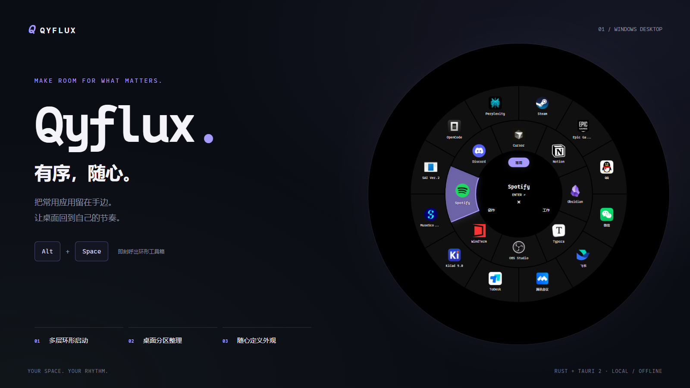
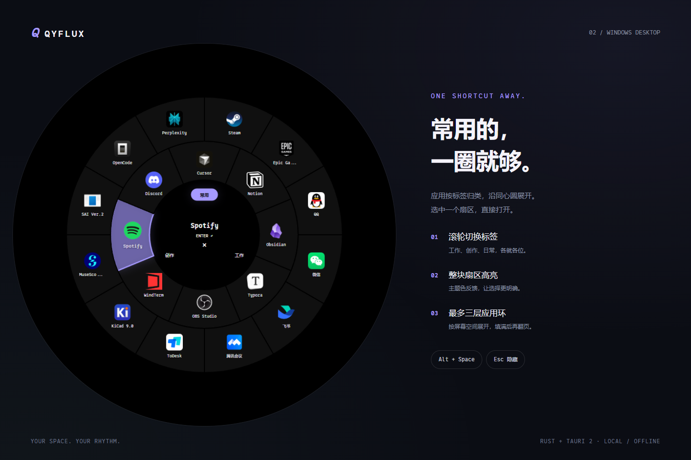
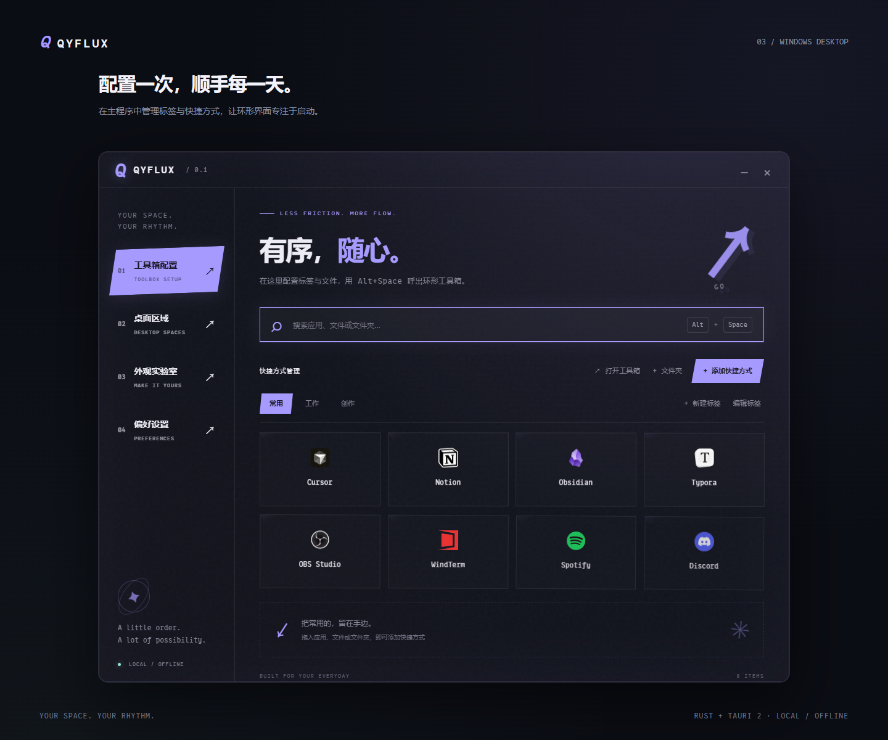
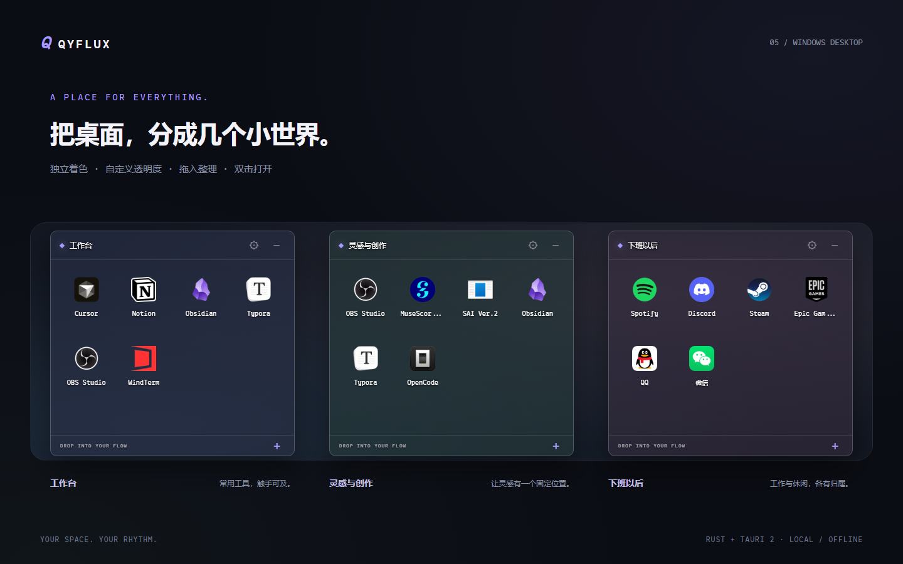
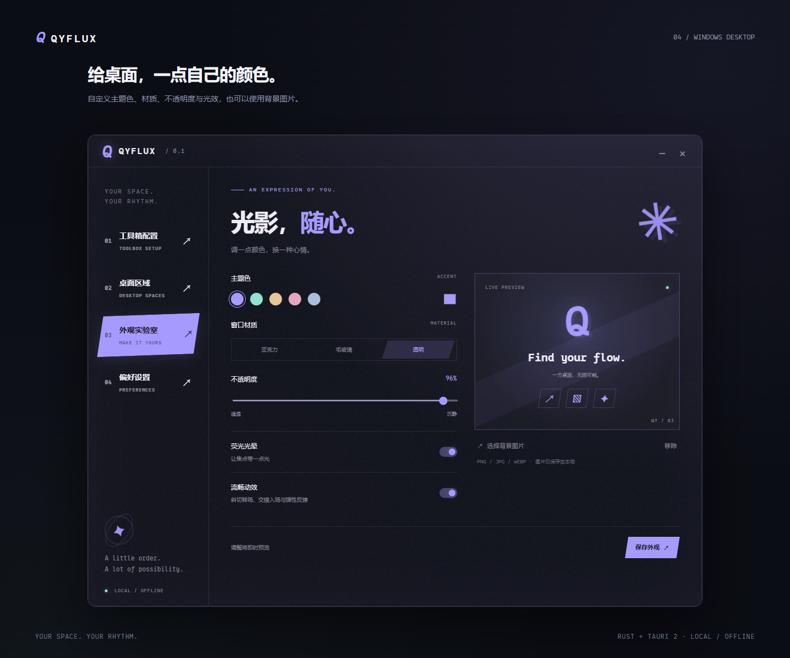

<p align="center">
  <strong>QYFLUX</strong><br>
  Your space. Your rhythm.
</p>



<p align="center">
  <strong>Windows 桌面美化与快捷启动工具</strong><br>
  多层环形菜单 · 桌面区域 · 自定义主题<br><br>
  <code>Rust</code> · <code>Tauri 2</code> · <code>Windows 10 / 11</code> · <code>0xProto</code>
</p>

<p align="center">
  <a href="https://github.com/JasmineAura/Qyflux/releases/latest"><strong>下载 Windows 版本</strong></a> ·
  <a href="#下载安装">下载安装</a> ·
  <a href="#功能亮点">功能亮点</a> ·
  <a href="#界面展示">界面展示</a> ·
  <a href="#开始使用">开始使用</a> ·
  <a href="#从源码运行">从源码运行</a> ·
  <a href="#已知限制">已知限制</a> ·
  <a href="#打赏作者">打赏作者</a>
</p>

Qyflux 把常用应用、文件和文件夹收进一个随时可唤起的环形工具箱，也为桌面提供可以自由摆放的整理区域。配置在主程序中完成，日常启动只需按下 **Alt + Space**。

> 项目处于早期开发阶段。下方展示图使用当前界面与示例数据制作；Windows 原生玻璃材质以实际运行效果为准。

## 下载安装

前往 **[GitHub Releases 下载最新版](https://github.com/JasmineAura/Qyflux/releases/latest)**，选择 `Qyflux-v版本号-windows-x64.zip`，解压后双击 `Qyflux.exe`。也可以直接下载单文件 `.exe`。

适用于 **Windows 10 / 11 x64**，无需安装 Rust 或 Node.js；运行需要 [Microsoft Edge WebView2 Runtime](https://developer.microsoft.com/microsoft-edge/webview2/)。`Source code` 是源码压缩包，普通用户请选择上面的预编译程序。

更新时先从托盘退出旧版，再替换程序。用户配置保存在 `%APPDATA%/studio.qyflux.desktop/`，更新程序后保留。

## 功能亮点

| 功能 | 体验 |
| --- | --- |
| 环形快捷启动 | 黑色不透明圆盘，独立扇区、主题色高亮，点击整个扇区均可启动 |
| 多层与标签 | 应用从内向外排列，最多三层；滚轮切换标签，当前页容量用满后再翻页 |
| 桌面整理区域 | 独立浮窗，可移动、缩放，分别设置底色与不透明度 |
| 清晰的应用图标 | 读取 Windows Shell 图标，优先使用 128px 或更高分辨率资源，并缓存有效结果 |
| 自定义外观 | 主题色、亚克力、毛玻璃、背景图片、不透明度与荧光效果 |
| 动效与字体 | 斜切转场、交错入场、弹性反馈；英文与数字使用 0xProto |
| 托盘与自启动 | 托盘快速访问，可选登录 Windows 后自动启动 |
| 本地保存 | 快捷方式、区域布局与主题配置保存在本机，日常使用无需联网 |

## 界面展示

### 一圈，回到常用

内圈放标签，应用按同心圆排列。将鼠标移入扇区即可看到主题色高亮和应用名称；使用鼠标或方向键选择，点击或回车启动。



### 配置一次，顺手每一天

在主程序中创建标签，将应用、快捷方式、文件或文件夹拖入对应分类。支持搜索、标签重命名、快捷方式跨标签移动和重新绑定失效文件。



### 给桌面里的每件事，一个位置

把工作、创作与休闲分成独立区域。每个区域都可以设置自己的底色和透明度，位置与尺寸自动保存。



### 外观，随你调整

从雾紫、薄荷、香槟、烟粉与雾蓝开始，或选择自己的主题色。光效与动效可以单独关闭，并遵循系统减少动态效果的偏好。



主窗口设置背景图片后，会使用不透明图片底层并停用玻璃材质；移除图片后恢复此前设置。环形工具箱始终使用不透明黑底，不显示背景图片；桌面区域保留各自的外观配置。

## 开始使用

1. 启动 Qyflux，在「工具箱配置」中创建标签。
2. 将应用、文件或文件夹拖入当前标签，也可以使用添加按钮选择。
3. 按 **Alt + Space** 呼出环形工具箱，选择应用启动。
4. 在「桌面区域」中创建区域，拖入需要整理的项目，双击打开。
5. 在「外观实验室」中调整主题，点击「保存外观」应用设置。

导入的 `.lnk` / `.url` 会保存一份软件内副本。普通文件、应用程序和文件夹保存的是引用，移除条目或删除区域不会删除原文件。软件内的快捷方式副本仍依赖其目标程序或文件存在。

### 快捷键

| 操作 | 快捷键 / 鼠标 |
| --- | --- |
| 呼出 / 隐藏工具箱 | `Alt + Space` |
| 切换标签 | 鼠标滚轮 / `Ctrl + ←` / `Ctrl + →` |
| 选择应用 | 鼠标移入扇区 / 方向键 |
| 启动所选应用 | 点击扇区 / `Enter` |
| 应用翻页 | 中心翻页箭头 / `PageUp` / `PageDown` |
| 隐藏工具箱 | `Esc` / 中心 `×` |
| 移动工具箱 | 拖动中心区域 |
| 打开桌面区域中的项目 | 双击 / 聚焦后按 `Enter` |

当标签超过 8 个时，可使用中心的「更多标签」切换下一组。托盘左键打开工具箱，右键菜单可打开控制面板或退出。关闭主窗口会隐藏到托盘；开机自启动默认关闭，可在「偏好设置」中开启。

## 从源码运行

### 环境要求

- Windows 10 / 11
- Rust 稳定版，使用 MSVC 工具链
- Visual Studio C++ Build Tools 与 Windows SDK
- Node.js 与 npm
- Microsoft Edge WebView2 Runtime

在项目根目录运行：

```bash
npm ci
npm run dev
```

### 构建可执行文件

```bash
npm run build
```

输出文件：`src-tauri/target/release/qyflux.exe`。当前构建命令生成可运行程序，不生成安装包；运行环境需要 WebView2 Runtime。

在 PowerShell 中生成下载包与校验值：

```powershell
./scripts/package-release.ps1
```

产物位于 `dist/`，包含 Windows x64 EXE、ZIP 与 `SHA256SUMS.txt`。

维护者后续可更新 `package.json`、`package-lock.json`、`src-tauri/Cargo.toml`、`src-tauri/Cargo.lock` 和 `src-tauri/tauri.conf.json` 的版本号，添加对应的 `docs/releases/v版本号.md`，提交后在 GitHub 的 **Actions → Build and publish Windows release → Run workflow** 输入版本号。工作流会检查、测试、编译并发布带下载附件的 Release。

### 检查与测试

```bash
npm run check
cargo test --manifest-path src-tauri/Cargo.toml
```

## 项目结构

```text
Qyflux/
├── ui/                      # 本地 HTML / CSS / JavaScript 界面
│   ├── app.js               # 控制面板与桌面区域
│   ├── toolbox.js           # 多层环形菜单与交互
│   ├── icons.js             # 图标加载与重试
│   └── fonts/               # 0xProto 字体及许可证
├── src-tauri/
│   └── src/
│       ├── main.rs          # 窗口、托盘、快捷键、设置与文件启动
│       └── native_icons.rs  # Windows Shell 图标提取与缓存
└── docs/images/             # README 展示图片
```

原生功能由 Rust 实现，Tauri 2 连接窗口与本地界面。前端使用原生 HTML、CSS 和 JavaScript，无前端框架、无远程页面内容。

## 数据与配置

用户数据保存在：

```text
%APPDATA%/studio.qyflux.desktop/
├── settings.json   # 快捷方式、标签、区域布局与外观
├── shortcuts/      # 导入快捷方式的内部副本
├── icons/          # 图标缓存
└── backgrounds/    # 导入的背景图片
```

设置使用临时文件替换方式保存，损坏配置会备份。移除背景图片仅取消引用。升级会保留旧配置，并补充新增设置的默认值。

## 已知限制

- 桌面区域是独立浮窗，不嵌入 Explorer 桌面层；使用系统「显示桌面」时可能被隐藏。
- 原生玻璃材质受 Windows 版本、系统透明效果与节能设置影响；展示图不代表所有设备上的实际材质效果。
- `Alt + Space` 被其他程序占用时，注册可能失败，仍可通过托盘访问。
- 环形菜单按屏幕空间显示最多三层应用环，容量依次为 8 / 12 / 16 项；较小屏幕可能显示更少层。
- 外部目标移动或卸载后，快捷方式可能失效，可通过卡片上的 `↻` 重新绑定。

## 打赏作者

如果 Qyflux 让你的桌面更顺手，欢迎请作者喝杯咖啡，支持后续开发与维护。打赏完全自愿，感谢你的支持。

<p align="center">
  <br>
  <strong>微信扫码 · 支持作者</strong>
</p>

## 反馈与致谢

欢迎通过仓库 Issues 提交问题或建议。界面问题请尽量附上截图、Windows 版本、显示缩放比例与复现步骤。

- [Tauri](https://tauri.app/) · 桌面应用框架
- [Rust](https://www.rust-lang.org/) · 原生功能实现
- [0xProto](https://github.com/0xType/0xProto) · 英文与数字字体，采用 SIL Open Font License，详见 [字体许可证](ui/fonts/OFL.txt)

展示图中的第三方应用图标仅用于说明快捷启动和分类功能，相关标识归各自所有者所有。
